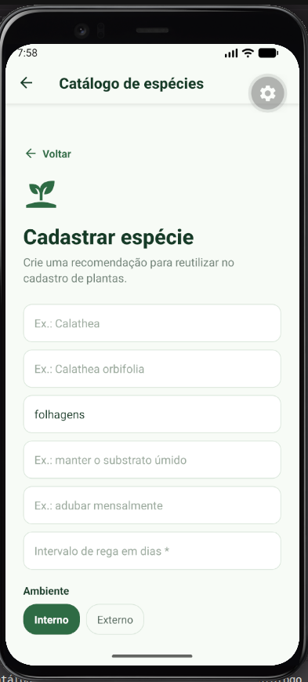

# Broto

Aplicativo mobile para organização dos cuidados com plantas. O usuário pode
cadastrar suas plantas, consultar recomendações por espécie, registrar regas e
acompanhar a próxima data de cuidado.

Este projeto foi desenvolvido para a disciplina de **Dispositivos Móveis**.

## Integrantes

| Integrante          | Responsabilidades                                                                                       |
| ------------------- | ------------------------------------------------------------------------------------------------------- |
| **Mariana Rinaldi** | Desenvolvimento completo: navegação, Firebase, formulários, UX, recursos nativos, testes e documentação |

## Funcionalidades

- Cadastro, edição e exclusão de plantas.
- Seleção de espécie por catálogo ou cadastro de uma nova espécie.
- Preenchimento automático de cuidados conforme a espécie escolhida.
- Registro de rega com atualização imediata da próxima rega.
- Status de cuidado: atrasada, regar hoje, regar amanhã ou próxima rega.
- Guia de cuidados com busca, filtros e detalhes por espécie.
- Tela Hoje com resumo dinâmico dos cuidados atrasados, de hoje e futuros.
- Busca e filtros funcionais em **Minhas plantas**.
- Catálogo visual em grade no **Guia de cuidados**.
- Inclusão de foto pela galeria ou câmera.
- Lembretes locais de cuidados.
- Feedback visual de carregamento, erro, sucesso e estado vazio.
- Confirmação antes de operações destrutivas.
- Interface acessível com labels, hints e alvos de toque adequados.
- Paleta e espaçamentos centralizados em `src/constants/theme.js`.

## Tecnologias

- React Native com Expo SDK 58.
- React Navigation com Native Stack e Bottom Tabs.
- Context API para estado global.
- Firebase Authentication com contas por e-mail e senha.
- Firebase Firestore com regras de acesso por proprietário.
- Expo Image Picker para câmera e galeria.
- Expo Notifications para lembretes locais.
- Expo Haptics para feedback tátil.
- `@expo/vector-icons` para ícones.
- Jest e React Native Testing Library para testes.

## Requisitos atendidos

### Arquitetura, layout e UX

- Código organizado em componentes, telas, serviços, contexto, constantes e
  utilitários.
- Componentes reutilizáveis para cards, botões de rega, status, seleção de
  espécies e estados de feedback.
- Sistema visual Botanical Minimalism com identidade verde unificada.
- Resumo visual dos cuidados na tela Hoje.
- Busca e filtros em **Minhas plantas**.
- Catálogo visual em grade no **Guia de cuidados**.
- Cards com estado vazio e fallback visual para plantas sem foto.
- Layout responsivo utilizando Flexbox.
- Feedbacks visuais para carregamento, erro, sucesso e ausência de dados.

### Navegação

- Native Stack integrado ao Bottom Tabs.
- Abas principais: **Hoje** e **Minhas plantas**.
- Fluxos de detalhes, cadastro, edição, guia de cuidados e cadastro de
  espécies.

### Estado e formulários

- Context API para compartilhamento das plantas entre as telas.
- `useState`, `useEffect`, `useMemo` e `useCallback` para estados e eventos.
- Formulário com validação dos campos obrigatórios.
- Seletores, inputs, calendário e feedback de validação.

### Recursos nativos

- Câmera e galeria para fotos das plantas.
- Notificações locais para lembretes.
- Haptics para confirmação de ações.
- DateTimePicker para escolha de datas.
- Ícones vetoriais com `@expo/vector-icons`.

### Firebase e persistência

- Firebase Authentication com sessão persistida no dispositivo.
- Firestore para leitura, criação, edição e remoção das plantas do usuário.
- Catálogo padrão local e espécies personalizadas privadas no Firestore.
- CRUD de espécies personalizadas.
- Atualização de `lastWateredDate`, `nextCareDate` e `nextCare` após a rega.

### Git Flow

- `main`: versão estável.
- `develop`: integração das funcionalidades.
- `feature/nome-da-funcionalidade`: desenvolvimento de cada recurso.
- Uso de Pull Requests e revisão antes do merge em `develop`.

## Estrutura do projeto

```text
src/
├── components/   # Componentes visuais reutilizáveis
├── config/       # Configuração do Firebase
├── constants/    # Tema e catálogo local
├── context/      # Estado global das plantas
├── navigation/   # Native Stack e Bottom Tabs
├── screens/      # Telas do aplicativo
├── services/     # Firestore e notificações
├── utils/        # Regras de negócio e datas
└── __tests__/    # Testes automatizados
```

Os principais componentes reutilizáveis incluem `CareStatusBadge`,
`WateringButton`, `PlantCareCard`, `SpeciesSelector`, `SearchBar`,
`FilterChip`, `CareSummaryCard`, `PlantCard` e `PlantCatalogCard`.

## Pré-requisitos

- Node.js LTS.
- npm.
- Android Studio com Android SDK e emulador configurado, ou dispositivo
  Android com depuração USB.
- JDK 17 para gerar a Development Build Android.

## Instalação

```bash
git clone https://github.com/marianarinaldi/broto-app.git
cd broto-app
npm install
```

### Executar com Expo Go

```bash
npx expo start --go
```

### Executar com Development Build

A Development Build é recomendada para testar câmera, notificações e outros
recursos nativos:

```bash
npx expo run:android
npx expo start --dev-client
```

Verifique se o dispositivo foi reconhecido:

```bash
adb devices
java -version
```

## Configuração do Firebase

1. Crie ou acesse um projeto no [Firebase Console](https://console.firebase.google.com/).
2. Crie um aplicativo Web no projeto e ative o **Cloud Firestore**.
3. Em **Authentication > Sign-in method**, habilite **E-mail/senha**.
4. Copie `.env.example` para `.env` e preencha as variáveis com a configuração
   do aplicativo Web no Firebase Console.

O arquivo `.env` é ignorado pelo Git. As variáveis `EXPO_PUBLIC_*` são incluídas
no aplicativo e podem ser inspecionadas; elas organizam a configuração, mas não
são segredos nem substituem as regras do Firestore. Restrinja a chave de API no
Google Cloud Console aos serviços e aplicativos necessários.

O aplicativo utiliza as coleções:

- `plants`: plantas com o campo `ownerId` igual ao UID da conta proprietária.
- `plant_catalog`: espécies personalizadas, também vinculadas a `ownerId`.

O catálogo padrão fica em
[`src/constants/plantCatalogData.js`](./src/constants/plantCatalogData.js) e
não precisa de gravação pública no Firestore.

### Regras do Firestore

As regras estão no arquivo [`firestore.rules`](./firestore.rules). Para
publicá-las usando a Firebase CLI:

```bash
firebase login
firebase use SEU_PROJECT_ID
firebase deploy --only firestore:rules
```

As regras permitem acesso a plantas e espécies personalizadas somente quando
`request.auth.uid` corresponde ao `ownerId` do documento. Faça backup dos dados
antes de publicar as novas regras.

#### Migração dos dados existentes

Os documentos antigos foram criados sem `ownerId`. Depois de publicar as novas
regras, eles não poderão ser lidos pelo aplicativo. Antes do deploy, exporte
uma cópia do Firestore e atribua cada documento ao UID verificado do proprietário
usando uma ferramenta administrativa confiável, como o Firebase Admin SDK.
Não atribua documentos automaticamente com base em e-mail ou em dados enviados
pelo aplicativo. Se não for possível confirmar quem é o proprietário, mantenha
o backup separado em vez de expor esses dados.

Depois de habilitar a autenticação e migrar os documentos que tenham um
proprietário confirmado, publique as regras. Teste com duas contas diferentes:
cada uma deve listar, editar e excluir somente as próprias plantas e espécies.
O identificador Android do aplicativo é `br.com.marianarinaldi.broto`; mudar
esse identificador exige instalar o app como uma aplicação separada no aparelho.

## Catálogo de espécies

O catálogo possui uma fonte local em
[`src/constants/plantCatalogData.js`](./src/constants/plantCatalogData.js).
O catálogo padrão não depende de seed nem de gravação no Firestore; as espécies
personalizadas são carregadas da conta autenticada. Se o Firestore estiver
indisponível, a fonte local continua disponível.

O usuário pode:

- consultar espécies;
- pesquisar por nome ou categoria;
- filtrar espécies;
- cadastrar uma nova espécie;
- editar e excluir espécies cadastradas pelo usuário;
- restaurar o catálogo padrão.

## Telas principais

### Hoje

A tela inicial apresenta um resumo dinâmico dos cuidados:

- plantas atrasadas;
- plantas que precisam de rega hoje;
- próximos cuidados.

Ela também oferece ações rápidas para cadastrar uma planta ou abrir o guia,
mostra as plantas prioritárias e permite registrar a rega diretamente no card.

### Minhas plantas

A tela de coleção pessoal permite pesquisar plantas pelo nome ou espécie e
filtrar por:

- Todas;
- Atrasadas;
- Regar hoje;
- Próximas.

Os cards exibem foto ou fallback, nome personalizado, espécie e status do
próximo cuidado.

### Guia de cuidados

O guia apresenta as espécies em um catálogo visual em grade. Há busca,
filtros por ambiente, cadastro de espécies personalizadas, edição e exclusão
das espécies criadas pelo usuário e restauração confirmada do catálogo padrão.

## Testes e validação

Execute os comandos abaixo antes da entrega:

```bash
npm audit
npm run lint
npm test -- --runInBand
npx expo export --platform android
```

As dependências transitivas vulneráveis de gRPC, glob e minimatch são fixadas
em versões corrigidas por `overrides` no `package.json`. Reavalie esses
overrides ao atualizar Expo, Firebase ou as ferramentas de teste.

Os testes cobrem o componente de recomendações, os ícones de cuidados, o
cálculo da próxima rega e a classificação dos status de cuidado.

O redesign também deve ser validado manualmente nos seguintes fluxos:

- busca de plantas por nome ou espécie;
- filtros de cuidados;
- registro de rega direta;
- atualização da próxima data;
- cadastro e edição de planta;
- navegação para detalhes;
- busca e filtros do catálogo;
- cadastro e edição de espécie;
- restauração do catálogo padrão;
- cadastro/login, encerramento de sessão e isolamento de dados entre duas contas;
- estados vazios e estados de erro.

## Screenshots e vídeo

### Tela inicial


### Minhas plantas


### Cadastro de planta


### Guia de cuidados


### Cadastro de espécie



### Vídeo

[Assistir ao vídeo de demonstração](https://drive.google.com/file/d/1CGDwQGzo37O8LxlHNpQnmnnlAm79F9Th/view?usp=sharing)
