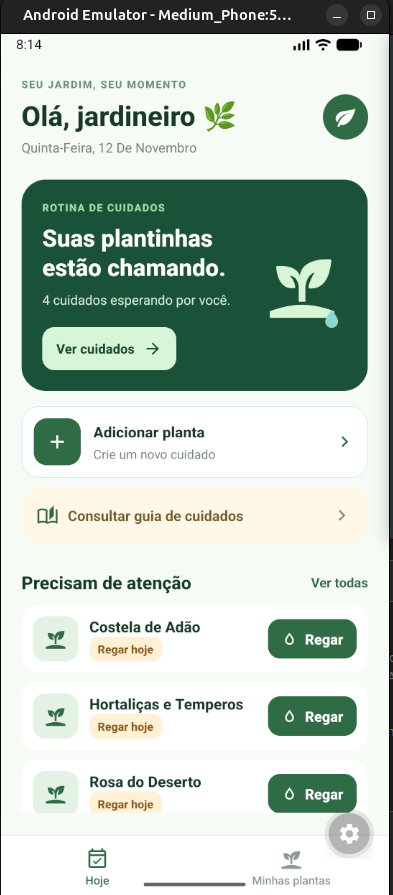
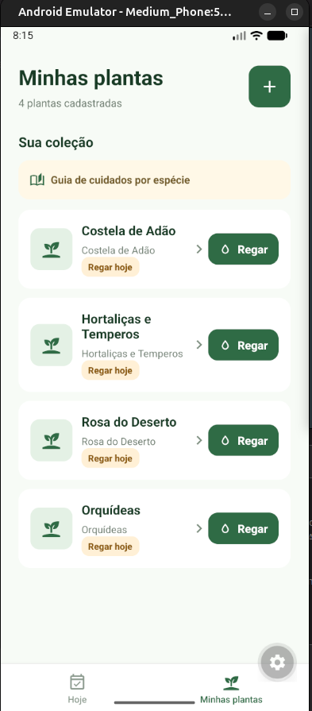
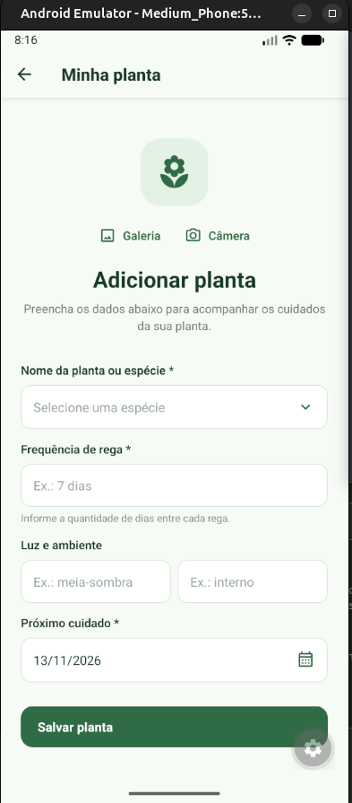
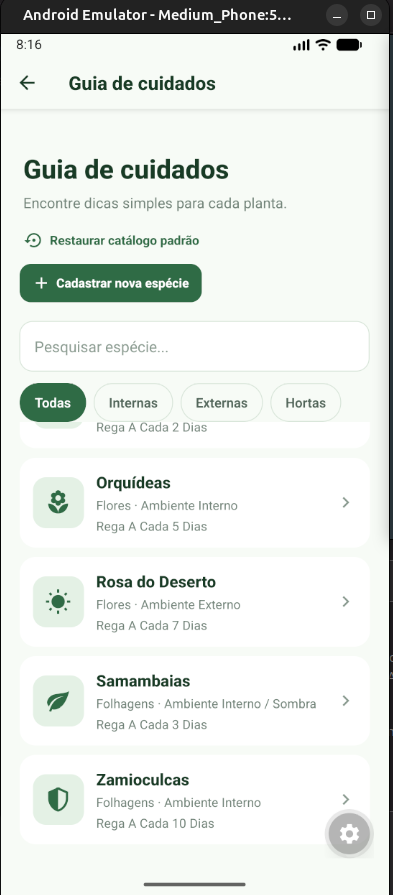

# Broto

Aplicativo mobile para organização dos cuidados com plantas. O usuário pode
cadastrar suas plantas, consultar recomendações por espécie, registrar regas e
acompanhar a próxima data de cuidado.

Este projeto foi desenvolvido para a disciplina de **Dispositivos Móveis**.

## Integrantes

| Integrante          | Responsabilidades                                                                                       |
| ------------------- | ------------------------------------------------------------------------------------------------------- |
| **Mariana Rinaldi** | Desenvolvimento completo: navegação, Firebase, formulários, UX, recursos nativos, testes e documentação |

## Funcionalidades

- Cadastro, edição e exclusão de plantas.
- Seleção de espécie por catálogo ou cadastro de uma nova espécie.
- Preenchimento automático de cuidados conforme a espécie escolhida.
- Registro de rega com atualização imediata da próxima rega.
- Status de cuidado: atrasada, regar hoje, regar amanhã ou próxima rega.
- Guia de cuidados com busca, filtros e detalhes por espécie.
- Inclusão de foto pela galeria ou câmera.
- Lembretes locais de cuidados.
- Feedback visual de carregamento, erro, sucesso e estado vazio.
- Confirmação antes de operações destrutivas.
- Interface acessível com labels, hints e alvos de toque adequados.

## Tecnologias

- React Native com Expo SDK 58.
- React Navigation com Native Stack e Bottom Tabs.
- Context API para estado global.
- Firebase Firestore para persistência NoSQL.
- Expo Image Picker para câmera e galeria.
- Expo Notifications para lembretes locais.
- Expo Haptics para feedback tátil.
- `@expo/vector-icons` para ícones.
- Jest e React Native Testing Library para testes.

## Requisitos atendidos

### Arquitetura, layout e UX

- Código organizado em componentes, telas, serviços, contexto, constantes e
  utilitários.
- Componentes reutilizáveis para cards, botões de rega, status, seleção de
  espécies e estados de feedback.
- Layout responsivo utilizando Flexbox.
- Feedbacks visuais para carregamento, erro, sucesso e ausência de dados.

### Navegação

- Native Stack integrado ao Bottom Tabs.
- Abas principais: **Hoje** e **Minhas plantas**.
- Fluxos de detalhes, cadastro, edição, guia de cuidados e cadastro de
  espécies.

### Estado e formulários

- Context API para compartilhamento das plantas entre as telas.
- `useState`, `useEffect`, `useMemo` e `useCallback` para estados e eventos.
- Formulário com validação dos campos obrigatórios.
- Seletores, inputs, calendário e feedback de validação.

### Recursos nativos

- Câmera e galeria para fotos das plantas.
- Notificações locais para lembretes.
- Haptics para confirmação de ações.
- DateTimePicker para escolha de datas.
- Ícones vetoriais com `@expo/vector-icons`.

### Firebase e persistência

- Firestore para leitura, criação, edição e remoção de plantas.
- Firestore para o catálogo de espécies.
- CRUD de espécies personalizadas.
- Atualização de `lastWateredDate`, `nextCareDate` e `nextCare` após a rega.

### Git Flow

- `main`: versão estável.
- `develop`: integração das funcionalidades.
- `feature/nome-da-funcionalidade`: desenvolvimento de cada recurso.
- Uso de Pull Requests e revisão antes do merge em `develop`.

## Estrutura do projeto

```text
src/
├── components/   # Componentes visuais reutilizáveis
├── config/       # Configuração do Firebase
├── constants/    # Tema e catálogo local
├── context/      # Estado global das plantas
├── navigation/   # Native Stack e Bottom Tabs
├── screens/      # Telas do aplicativo
├── services/     # Firestore e notificações
├── utils/        # Regras de negócio e datas
└── __tests__/    # Testes automatizados
```

## Pré-requisitos

- Node.js LTS.
- npm.
- Android Studio com Android SDK e emulador configurado, ou dispositivo
  Android com depuração USB.
- JDK 17 para gerar a Development Build Android.

## Instalação

```bash
git clone https://github.com/marianarinaldi/broto-app.git
cd broto-app
npm install
```

### Executar com Expo Go

```bash
npx expo start --go
```

### Executar com Development Build

A Development Build é recomendada para testar câmera, notificações e outros
recursos nativos:

```bash
npx expo run:android
npx expo start --dev-client
```

Verifique se o dispositivo foi reconhecido:

```bash
adb devices
java -version
```

## Configuração do Firebase

1. Crie ou acesse um projeto no [Firebase Console](https://console.firebase.google.com/).
2. Crie um aplicativo Web no projeto.
3. Ative o **Cloud Firestore**.
4. Copie a configuração do aplicativo Web.
5. Atualize os valores em
   [`src/config/firebaseConfig.js`](./src/config/firebaseConfig.js).

O aplicativo utiliza as coleções:

- `plants`: plantas cadastradas pelo usuário.
- `plant_catalog`: catálogo de espécies e espécies personalizadas.

### Regras do Firestore

As regras estão no arquivo [`firestore.rules`](./firestore.rules). Para
publicá-las usando a Firebase CLI:

```bash
firebase login
firebase use SEU_PROJECT_ID
firebase deploy --only firestore:rules
```

As regras atuais são destinadas à demonstração acadêmica. Antes de uma
publicação comercial, implemente Firebase Authentication, associe cada
documento a um `userId` e restrinja o acesso por usuário.

## Catálogo de espécies

O catálogo possui uma fonte local em
[`src/constants/plantCatalogData.js`](./src/constants/plantCatalogData.js).
Quando o Firestore está vazio, o aplicativo realiza o seed do catálogo padrão.
Se o Firestore estiver indisponível, a fonte local é utilizada como fallback.

O usuário pode:

- consultar espécies;
- pesquisar por nome ou categoria;
- filtrar espécies;
- cadastrar uma nova espécie;
- editar e excluir espécies cadastradas pelo usuário;
- restaurar o catálogo padrão.

## Testes e validação

Execute os comandos abaixo antes da entrega:

```bash
npm run lint
npm test -- --runInBand
npx expo export --platform android
```

Os testes cobrem o componente de recomendações, os ícones de cuidados, o
cálculo da próxima rega e a classificação dos status de cuidado.

## Screenshots e vídeo

### Tela inicial



### Minhas plantas



### Cadastro de planta



### Guia de cuidados



### Vídeo

[Assistir ao vídeo de demonstração](https://drive.google.com/file/d/1YM5sCU_lB0A7deMaonGdF3bcUcMw-kYJ/view?usp=sharing)
